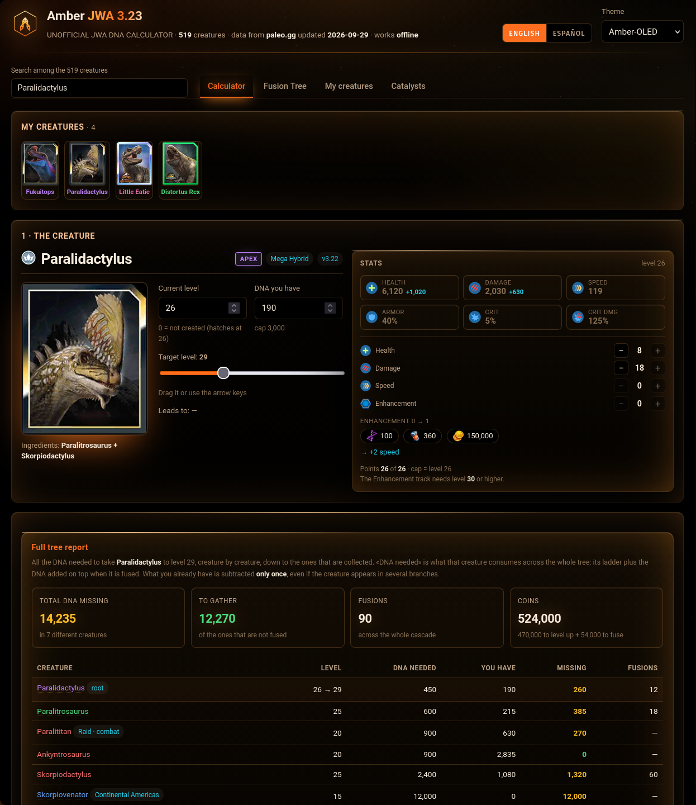

<h1><picture><source media="(prefers-color-scheme: dark)" srcset="img/logo.svg"></picture> <picture><source media="(prefers-color-scheme: dark)" srcset="img/readme/titulo-oscuro.svg"></picture></h1>



A DNA and cost calculator for Jurassic World Alive 3.23.

Amber answers one question: how much DNA, how many coins and how many fusions it
takes to bring any creature in the game to the level you want, and which
ingredients you need in cascade to fuse the hybrids on the way.

It is one self-contained HTML file. No server, no CDN, no install step. Open it
and it works offline, with your data in your own browser. The interface is in
English and Spanish, and it ships with seven themes.

Live site: **[neomikr0n.github.io/amber-jwa-calculator](https://neomikr0n.github.io/amber-jwa-calculator/)**,
serving the same `index.html` this repository builds. The creature photos are
missing there on purpose.

---

## What it does

- **Calculator.** Pick any of the 524 creatures, set the level you have and the
  level you want. You get the DNA, the coins and the number of fusions it takes,
  and what you are missing.
- **Fusion tree.** The full ingredient cascade for any hybrid, down to the
  creatures you dart in the wild. Every node is editable: type a level and a DNA
  figure, or untick *Created*, and everything below it recalculates. The tree is
  drawn complete whatever the target level, and the branches you already cover
  are marked *not needed* and add nothing to the totals. Pressing a name opens
  that creature.
- **Darting sessions.** Beside *Fusions*, the report says how many darting
  sessions it takes to gather the DNA a creature needs. Set your player level
  next to the search box, up to 35, and the figure follows it. One session is at
  most 15 darts, all of them direct hits, so the number is the least it can take
  and a real session brings less. It only appears where the game publishes the
  numbers, and the «?» beside the column heading explains the rest.
- **My creatures.** Everything you enter is saved in the browser with a target
  level per creature, and exports as JSON. On the creature's card, one button
  saves it or takes it out of the list, depending on which it already is.
- **Real stats.** Health, damage, speed, armour and both critical values at any
  level, with the enhancement track and its cost, and the creature's class badge.
- **Omega training.** Omegas earn 7 training points per level and spend them on
  their six stats, each with its own increment and cap, as paleo.gg's table
  describes. An Omega does not grow with the level: its base is the level-26
  value, and levelling gives it points.
- **Catalysts.** A recombination planner, marked unverified in the interface
  because the game does not publish the rates.
- **Themes.** The deep-black default, five amber variants (Crystal, Neon, OLED,
  Liquid, Cinema) and *Boring*, the original slate-and-green look. The choice
  survives a reload, and the motion switches off under `prefers-reduced-motion`.

## FAQ

### How do I get my creatures onto another device, or onto the live site?

**Export JSON**, under *My creatures* → *Summary*, downloads
`jwa322-mis-criaturas-<date>-<time>.json`, for example
`jwa322-mis-criaturas-2026-10-02-1747.json`, in your own local time. It is a
plain-text file with two things: the data of every creature you have entered a
figure for (level, DNA held, enhancement points), including the ones you only
opened inside a fusion tree, and the list of the ones you saved on purpose, each
with its target level. It is the only thing that carries your data out of the
browser.

On the other device, open Amber and press **Import JSON**. That is also the way
between your local copy and the live site: the browser treats them as two
different pages, each with its own store, and the file is the bridge.

### Does importing replace what I have, or add to it?

It adds. Importing never wipes anything. For every creature in the file, its data
replaces that same creature's data if you already had it, and the ones you did not
have are added to *My creatures*. Nothing is duplicated. The confirmation tells
the two apart: «Imported 12 creatures, 3 added to My Creatures» means nine were
already there and were updated, and three were new.

### What is inside the file, and will an old one still import?

It is plain JSON. The two keys that matter are `inventario` (the data per
creature) and `mios` (the list you saved); what is left is a version mark. Older
files still import. The file carries a `jwa322` mark, and neither the mark nor the
file name contains the **game** version, on purpose, so the page keeps recognising
its own files across game updates. Files from before the mark existed, a plain
object of creature keys, are read too, and their keys become your saved list.

### What if the file is wrong?

It says so and changes nothing. Anything that is not a JSON object, an array or a
truncated download, is refused with «That file is not valid», and the import stops
before touching your data. Enhancement points that do not fit the level they
arrived with are trimmed as they are read, so what you see after importing is what
is still there after a reload.

### And «Clear all»?

It deletes every saved creature and the stored data, targets included, on that
page, and it cannot be undone. Export first if there is any doubt.

Nothing above leaves your machine: there is no account and no server, and the data
lives in the browser's `localStorage`.

## Build it

You need none of this to use it: `index.html` is committed, so cloning the
repository and opening that file is the whole installation. Building it from
source asks for Python 3 and git.

```bash
# Windows 11, in PowerShell. The interpreter there is python, or py, not python3.
winget install --id Python.Python.3.13 --exact
winget install --id Git.Git --exact

# macOS
xcode-select --install        # Python 3 and git ship with the Command Line Tools
# or, with Homebrew: brew install python git

# Arch Linux
sudo pacman -S --needed python git

# all three
git clone https://github.com/neomikr0n/amber-jwa-calculator.git
cd amber-jwa-calculator
python3 build.py
```

`winget search Python.Python` lists the newer lines if 3.13 has been superseded.

The build writes `index.html`: one self-contained file you open by double-clicking
and the same file the site serves. It is generated, never edited by hand, and its
name carries no version on purpose. A `file://` page keys `localStorage` to the
full path, so renaming the file creates an empty store and strands the old one.
That store is your saved creatures, and one stable name is what keeps them
reachable.

Only Python 3 is needed, with no third-party dependencies, to build it or to run
the fourteen tests. The one exception is `img/readme/generar-titulo.py`, which
draws the title artwork at the top of this file and needs `fontTools`; it is run by
hand, and the three SVGs it writes are committed.

The browser tests are the one part shaped for Linux: they launch Firefox at
`/usr/lib/firefox/firefox`, so on Windows and macOS those two need the path
changed or a `PATH` that resolves it.

## Regenerate the data

The creature data is committed, so this is only needed when the game updates.
`--version` is mandatory: it is the one thing an update changes, and it is written
into the data (`meta.version_juego`) so that the whole project reads the version
from a single place. No file name carries it.

```bash
python3 scrape_paleo.py --version 3.24   # rebuilds cache/ and data/jwa.json
python3 build.py                         # rebuilds index.html from it
python3 verificar_version.py             # fails until every mention agrees
python3 descargar_imagenes.py            # optional: fetches the creature photos
```

`scrape_paleo.py` downloads the dinodex and writes `cache/`, about 92 MB, which is
regenerable and therefore not in the repository.

`descargar_imagenes.py` fetches the 524 creature images into `img/`. They are not
in the repository and are not published on the site, because they are copyrighted
game artwork; see `NOTICE`. Without them the calculator still works: each image
hides itself on error and the layout falls back to names and figures.

## The one-file demo

```bash
python3 build.py              # the artefact first: the demo packs THAT file
python3 build_demo.py         # -> amber-demo.html (~1 MB)
```

`build_demo.py` packs the delivered artefact, the creature photos of a saved file,
the interface icons and a seed script into one HTML that opens with a double click,
needs no `img/` folder next to it and no network, and starts with those creatures
already loaded, in Spanish and in Amber-OLED. It packs the artefact instead of
building the template a second time, and it stamps the sha256 of what it packed;
`probar_demo.py` recomputes it, so a demo left behind by an older artefact is
caught instead of being shown.

It is not in the repository: it carries the creature photos inlined, and the saved
file it seeds lives in `.privado/`, which is not published either.

## Tests

The calculator is verified against an independent Python model of the same costs,
and against the source pages. Every script is standalone:

```bash
python3 modelo.py             # 40 self-check cases plus level-cap invariants
python3 verificar_motor.py    # the HTML engine against modelo.py, field by field
python3 verificar_arbol.py    # the fusion tree, node by node
python3 verificar_fuentes.py  # ingredient relationships and fusion levels
python3 verificar_recetas.py  # the recipes, against the RENDERED source page
python3 verificar_stats.py    # stats, boosts and the level multiplier table
python3 equivalencia.py       # the engine inside a real browser vs modelo.py
python3 probar_ui.py          # interface behaviour in a real browser
python3 probar_estres.py      # cost and tree edge cases
python3 probar_rareza.py      # rarity colours and contrast
python3 verificar_idioma.py   # dictionary parity, English default, pin precedence
python3 probar_demo.py        # the one-file demo: nothing external, nothing stale
python3 verificar_version.py  # one version, and every place that shows it agrees
python3 probar_version.py     # the one above fails when it should, and the update holds
```

The browser tests need Firefox at `/usr/lib/firefox/firefox` and pin the interface
language to Spanish, which is the language their assertions are written in.

Ten of the fourteen need material that is not in the repository, so on a fresh
clone they cannot judge anything: three read `cache/`, three load `img/*.webp`,
three read `.privado/LEEME.md`, and `probar_demo.py` reads `amber-demo.html`. All
ten say so. They print `RESULT: cannot judge —`, name what is missing and exit 2,
which is not 1. A test that cannot read what it verifies has not failed, it has not
run, and a clone used to get a list of things that «no longer add up» followed by
`FAIL`, which reads exactly like a defect in the code. The other four, `modelo.py`,
`verificar_arbol.py`, `equivalencia.py` and `verificar_idioma.py`, do give a
verdict on a clone.

`verificar_recetas.py` closes the last hole in the chain. Everything else compares
the page against `modelo.py`, and both read the same `data/jwa.json`, so a wrong
extraction would make the two wrong together. That script re-reads the ingredients
and the children from the rendered HTML of the cached page, while `scrape_paleo.py`
reads the JSON payload, so the extraction is checked through a second door.

## Where the data comes from

Creature data is extracted from **[paleo.gg](https://paleo.gg)**, which the
application credits on screen. Costs and fusion rules were cross-checked against
the site's own calculator, against the official 3.23 release notes, and against the
`jurassic-journal` database.

The DNA per fusion is an average of 22. Each fusion returns a random amount, so the
computed number of fusions is an estimate, not a promise.

One figure is not from the source, and it says so. An Omega's training table, where
each stat tops out, what one point adds and how many points that takes, is
paleo.gg's own. The pool of 7 points per level is not published anywhere: it comes
from two figures of a secondary guide (idgt902: a level 26 Omega has 182 points,
one at level 11 has 77), which land exactly on 7, and the game's own screen
confirms it, where a level 21 Omega with everything spent shows 147. The manual
carries it as medium-high confidence, not as an official number.

## Licence

Source code: Apache License 2.0, see `LICENSE`.

Third-party data, trademarks and the artwork that is deliberately not distributed:
see `NOTICE`. The licence covers the code in this repository and does not extend to
the game data. This is an unofficial fan project with no connection to the game's
owners.

---

## Thanks

- **And of course to Ludia 🦖**, who make
  **[Jurassic World Alive](https://jurassicworldalive.com/)**, the game all of
  this is about. Every creature, every stat and every cost in Amber is a
  description of their work. Amber is an unofficial fan project with no
  connection to them. Thank you for the game.
- **Congratulations to [paleo.gg](https://paleo.gg) 🎉.** Their dinodex is the
  backbone of this tool: every creature, every DNA cost, every coin figure and
  every ingredient in Amber comes from their pages, and their own calculator is
  what this one was checked against, field by field.
- **A shout-out to [isiynen](https://github.com/isiynen) 👏**, author of
  **[jurassic-journal](https://github.com/isiynen/jurassic-journal)**, the
  offline companion app for Jurassic World Alive. Their database was one of the
  independent readings the cost model was verified against.

Work in progress tho... 🚜👷🚧🏗️


